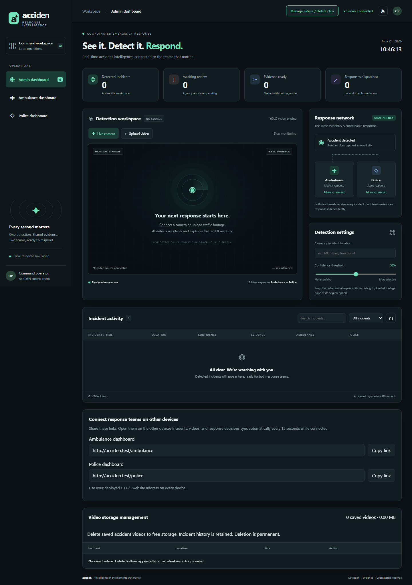
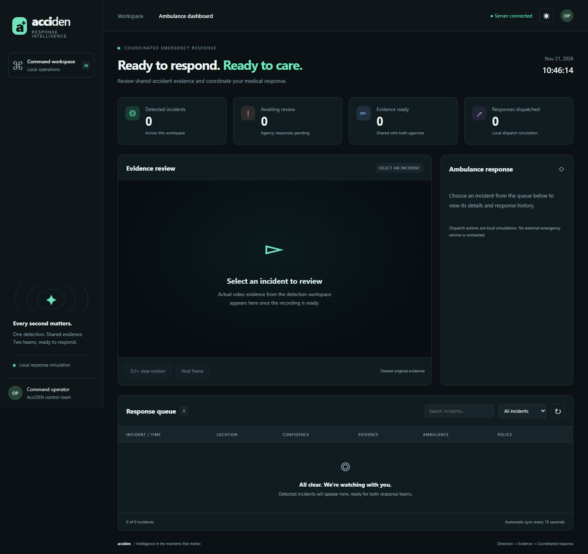
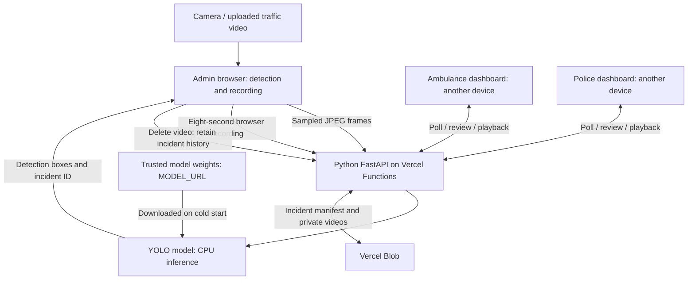

# AcciDEN — AI Accident Detection

Accident detection with shared video evidence and coordinated ambulance and police response dashboards.

**Detect an incident → capture evidence → review independently → coordinate a simulated response.**

## Features

- Analyze a live camera or uploaded traffic footage using a trained YOLO model.
- Capture eight seconds of source video with detection overlays after an accident is detected.
- Share the same incident and evidence with Ambulance and Police dashboards.
- Confirm, reject, and resolve responses independently for each agency.
- Delete stored accident videos from Admin while retaining incident history.
- Switch dashboards within one browser tab, preserving page and camera state.
- Sync connected devices through a shared backend every 15 seconds.
- Support light and dark themes and responsive layouts.

## Screenshots

The screenshots below show the current interface in its empty state. They were captured with mocked API responses for documentation; they do not demonstrate live inference or an active emergency.

### Admin dashboard

Monitor traffic, configure detection, share dashboard links, and manage video storage.



### Ambulance dashboard

Review shared evidence and record the medical team's simulated response.



### Police dashboard

Review the same incident and record an independent police response.


## Architecture

The cloud deployment serves the frontend and Python API from one Vercel project. A private Vercel Blob store persists incident metadata and recordings.



See [architecture details](docs/ARCHITECTURE.md) for persistence, playback, synchronization, and the local development mode.

## Dashboard routes

| Route | Purpose |
| --- | --- |
| `/admin` | Camera/video detection, incident activity, sharing links, and video deletion |
| `/ambulance` | Evidence review and independent medical response |
| `/police` | Evidence review and independent police response |

Dashboard navigation buttons appear only on Admin. Other devices open their dashboard using the same deployed domain. No workspace password is required.

## Technology

| Component | Technology |
| --- | --- |
| Frontend | HTML, CSS, JavaScript, Canvas, MediaRecorder |
| Cloud API | Python, FastAPI, Vercel Functions |
| Inference | Ultralytics YOLO, PyTorch, OpenCV |
| Cloud persistence | Private Vercel Blob store |
| Local backend | FastAPI, Uvicorn, local files, Socket.IO integrations |
| Checks | Node.js tests, Python API tests, GitHub Actions |

## Getting started

For local use, install Python dependencies from `requirements.txt`, then run:

```sh
python server.py
```

On Windows, `START_UPDATED_APP.bat` opens the updated local Admin dashboard.

Frontend checks:

```sh
npm ci
npm run check
npm test
npm run build
```


## Project structure

```text
api/index.py             Cloud API and detection endpoints
backend/storage.py       Vercel Blob persistence and manifest coordination
static/                  Dashboard HTML, CSS, and JavaScript
model/epoch61.pt          Trained weights tracked through Git LFS
docs/                    Screenshots and architecture documentation
scripts/                 Frontend build, checks, and documentation capture
tests/                   Cloud API regression tests
server.py                Original local backend
vercel.json              Vercel build and routing configuration
```

## Prototype scope

Dispatch actions are simulations; the app does not contact real emergency services. Locations are entered by the operator. The current app has no login or role-based API authorization: anyone who can access the deployment can use its dashboard actions. Recognition quality depends on the trained model and footage. Keep the monitoring page open during capture and upload.

## Accident detection

The local and cloud dashboards use the same single-frame YOLO detection as `test.py`. By default, each sampled image runs through `epoch61.pt` at 320 pixels with a 25% confidence threshold. If a live camera frame returns no boxes at 320 pixels, the detector retries that frame at 640 pixels. A box labeled `accident` can immediately trigger an incident. Other classes appear as vehicles. The existing resolution and confidence controls let the operator adjust these defaults.

Model confidence is a detection score. Evaluating the model requires labeled accident and normal-traffic footage. The available indoor negative clip is not a representative validation set.

Uploaded videos pause while the cloud checks sampled frames so short events are not skipped during inference. Evidence records at normal speed. The supplied ZIP's 2.47-second annotated demo can test prediction display but cannot supply a full eight-second evidence recording. Prefer original uploaded traffic footage over filming a phone screen. The ZIP weights match the deployed model; no new model was trained.
