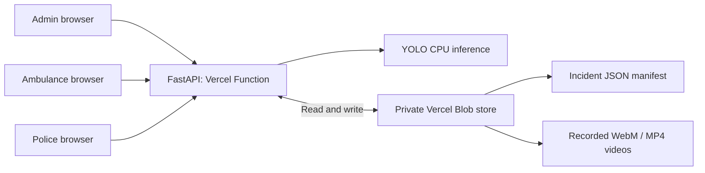

# AcciDEN architecture

## Cloud deployment

The three dashboards share one Vercel origin and one private Blob store. Browser JavaScript sends requests to the same origin's `/api` routes. Vercel routes these requests to `api/index.py`.

## Detection and evidence

1. Admin opens a live camera or uploaded video in the browser.
2. The browser sends sampled JPEG frames to `/api/detect`.
3. The API downloads trusted weights from `MODEL_URL` when needed and performs CPU inference.
4. A new accident creates an incident ID. A shared detection cooldown reduces repeated incidents.
5. The browser records the next eight seconds of source video with overlays and uploads it.
6. The API validates the recording and stores it in private Blob storage. Cloud recordings retain their original WebM or MP4 format and have a 3 MB upload limit.
7. Ambulance and Police obtain the same incident and evidence through their polling requests.

## Shared state and simultaneous updates

`backend/storage.py` stores incident records in a JSON manifest. A Blob lease serializes manifest writes, and record versions reject stale updates from another device. A timed-out invocation can leave a lease until its expiry. This is a small-demo persistence design, not a high-volume database.

Each agency has its own response record. One agency's confirmation or rejection does not overwrite the other agency's decision. Connected dashboards poll every 15 seconds and refresh when brought into focus. There is no cloud WebSocket dependency.

## Video playback and deletion

The API proxies video bytes from private Blob storage and supports byte ranges for playback. The browser does not receive the Blob read-write token.

Admin's Delete video action marks evidence as deleted, removes the stored video object, then clears its metadata. The incident and response history remain. A failed object deletion keeps the reference so the action can be retried. The UI hides navigation and storage controls on response dashboards; this is presentation behavior, not API access control.

## Navigation

The sidebar switches views inside the current page using the History API. It opens no new tab and does not reload the camera. Other devices use direct `/ambulance` or `/police` links on the same deployed domain. Switching or backgrounding the page can be subject to browser media and timer throttling.

## Local mode

`server.py` is the original local FastAPI/Socket.IO backend. It keeps local incident records and clips on disk and provides video conversion. Its storage is separate from the Vercel Blob implementation. Running locally does not upload existing local incidents to the cloud.

## Configuration and limits

- `BLOB_READ_WRITE_TOKEN`: server-side private storage credential.
- `MODEL_URL`: trusted direct HTTPS model download; private Vercel Blob URLs are supported.
- `API_BASE_URL`: leave unset for the combined Vercel deployment.
- Python package size, model cold starts, CPU/memory use, transfer, and storage must fit the selected Vercel plan.

The current app has no user login. Automated API tests use simulated persistent storage. Live model inference, Blob operations, and account limits must be verified after deployment.
